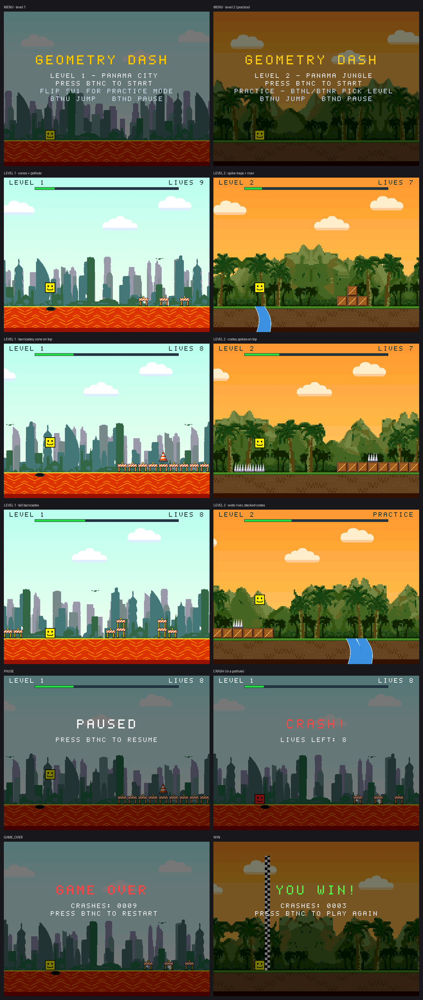

# FPGA Geometry Dash: Nexys A7-100T

A Geometry Dash–style runner game in Verilog for the Digilent Nexys A7-100T. It is built on the EE354 VGA example code and uses the main state machine from the project design. The player is a square that runs on its own, and you jump to get through two levels set in Panama:

| Level | Speed | Look | Obstacles |
|---|---|---|---|
| **1 – Panama City** | 5 px/frame (~24 s) | mint sky, Panama skyline, lava road | traffic cones, construction barricades, **potholes** |
| **2 – Panama jungle** | 6 px/frame (~20 s) | sunset sky, pixel-art mountains + palms (two parallax layers), grass and dirt | steel spike traps, wooden crates, **rivers** |



*Every image above was drawn by the RTL in simulation, not mocked up (see [Simulation](#simulation)). Moving versions: `docs/parallax_city.gif`, `docs/parallax_jungle.gif`.*

## Controls

| Input | Action |
|---|---|
| **BtnU** | Jump. Hold it to jump again as soon as you land |
| **BtnC** | Start (MENU), resume (PAUSE), leave GAME OVER / WIN |
| **BtnD** | Pause |
| **BtnL / BtnR** | Pick level 1 or 2 in the menu (practice mode only) |
| **SW0** | Reset the game (held = stay in INIT) |
| **SW1** | Practice mode: unlimited lives and level select |
| **SW15** | Show the FSM state number on the seven-segment displays |

**Seven-segment displays** (An7 is the leftmost digit):

| Digits | Shows | Example |
|---|---|---|
| An7 An6 | `L` + level | `L1` |
| An5 An4 | blank + lives (`P` in practice mode) | ` 9` |
| An3 … An0 | jump counter: every take-off, 0000–9999, reset in INIT | `0042` |

So the display reads e.g. `L1 9 0042`. With SW15 on it reads `StAtE  3`, where the last digit is the state number. The GAME OVER and YOU WIN screens also show `JUMPS: 0042`.

## State machine

`src/game_sm.v` is the group's FSM (version 2: jump counter, potholes/rivers, 2 levels). Compared with the original design diagram, three labels change: INIT also clears `jumps`, PLAY counts `jumps + 1` on every take-off (and no longer counts crashes), and LEVEL_CLEAR checks `level < 2` instead of `level < 3`.

| # | State | What it does | Goes to |
|---|---|---|---|
| 0 | INIT | lives ← 9, jumps ← 0, level ← 1, timer ← 0 | MENU |
| 1 | MENU | SW1 & BtnL: level − 1 · SW1 & BtnR: level + 1 | BtnC → LOAD |
| 2 | LOAD | scroll ← 0, velocity ← 0, runner on the floor | PLAY |
| 3 | PLAY | timer ← 0; on tick: scroll + speed, update runner; take-off: jumps + 1 | hit → CRASH (lives − 1 if !SW1) · finish & !hit → LEVEL_CLEAR · BtnD → PAUSE |
| 4 | PAUSE | hold all, show PAUSED | BtnC → PLAY |
| 5 | CRASH | on tick: timer + 1, show CRASH (60 ticks = 1 s) | on tick with timer = 59: (lives > 0 \| SW1) → LOAD · lives = 0 & !SW1 → GAME_OVER |
| 6 | LEVEL_CLEAR | lasts 1 clock | level < 2: level + 1 → LOAD · level = 2 → WIN |
| 7 | GAME_OVER | hold all | BtnC → INIT |
| 8 | WIN | hold all | BtnC → INIT |

A **tick** is one clock per video frame (60 Hz). It fires at the start of vSync, while the screen is blank, so the picture never tears. SW0 forces INIT from any state. INIT also parks the runner at the start so the menu shows a clean scene.

## Files

| File | Origin | Role |
|---|---|---|
| `src/vga_top.v` | EE354 example, extended | Top level: buttons (class `ee201_debouncer`), switches, frame tick, jump counter → decimal, SSD content |
| `src/display_controller.v` | EE354 example, **unchanged** | 640×480 VGA timing |
| `src/vga_bitchange.v` | EE354 example, rewritten | Renderer: (hCount, vCount) → 12-bit colour, two themes |
| `src/counter.v` | EE354 example, extended | SSD driver, now 8 digits plus letters (same scan + segment table) |
| `src/game_sm.v` | group FSM, v2 | Main FSM, runner physics, collision (blocks, spikes, holes), jump counter |
| `ee201_debouncer.v` | class file (not included) | Button debouncer used by `vga_top`; must be in the Vivado project |
| `src/debouncer.v` | new, now unused | Earlier debouncer; can be removed from the project |
| `src/level_rom.v` `font_rom.v` `text_rom.v` | generated | Level layouts, 5×7 font, on-screen messages |
| `src/skyline_rom.v` | generated | City background (two parallax layers) + cloud sprites |
| `src/jungle_rom.v` | generated | Jungle background: mountains layer + palms layer (130 × 48 art pixels each, 15 colours) |
| `src/sprite_rom.v` `hole_rom.v` | generated | Obstacle sprites for both themes; pothole / river floor overlays |
| `assets/skyline.png` `assets/jungle.jpg` | source art | The two background pictures |
| `constraints/vga_demo.xdc` | EE354 example | Same file with Sw0, Sw1, Sw15, BtnL, BtnR, BtnD enabled |
| `tools/gd_model.py` | new | Python model of the game, level definitions, solver |
| `tools/gen_roms.py` | new | Level / font / text ROMs and the test jump schedules |
| `tools/gen_skyline.py` `gen_jungle.py` `gen_sprites.py` | new | Make the background and sprite ROMs (`layer_rom.py` is a helper) |
| `sim/` | new | Testbenches (`game_sm_tb.v` is the group's), `run_all.sh`; `sim/models/` holds a simulation-only stand-in for `ee201_debouncer` (don't add it to Vivado) |

**The 12 files in `src/` that `vga_top` uses (everything except the unused `debouncer.v`) plus the class `ee201_debouncer.v` must be in the Vivado project.**

## Building in Vivado

**GUI:** create an RTL project for part **xc7a100tcsg324-1**. Add every file in `src/` as a design source and `constraints/vga_demo.xdc` as the constraint. Set `vga_top` as the top module, then generate the bitstream.

**Batch:** `vivado -mode batch -source build.tcl` writes `vivado/gd_nexys.runs/impl_1/vga_top.bit`, plus utilization and timing reports.

Expected size, from a Yosys `synth_xilinx` run: about 7,300 LUTs and 250 flip-flops, roughly 11% of the XC7A100T. There's no block RAM; all the pictures are LUT ROMs.

## How it works

- **World:** each level is a row of 32-px tiles (`level_rom`). `scroll` is the world x at the left edge of the screen. It grows by 5 px per frame on level 1 and 6 px on level 2, and the level is cleared at scroll = 7168.
- **Runner:** a 32×32 square at screen x = 128. `runner_h` is the height of its bottom above the floor. Jumping sets the speed to 12 px/frame and gravity removes 1 px/frame each frame, so a jump peaks about 78 px up.
- **Collision:** `game_sm` looks up the 1–2 tiles under the runner and works out:
  - **support:** the highest block top it can stand on. You can land up to 12 px below a top and snap up onto it.
  - **hit:** whether it touched a spike (cone), ran into the side of a block (barricade/crate), or is standing on the floor over a hole (pothole/river). For a hole, you die if you're on the ground (height 0) while your feet (runner x +8..+23) overlap the middle of the hole (tile x 4..27). Being in the air at that moment means you clear it.

  This logic is pipelined through two register stages so every 100 MHz path stays short. Positions only change once per frame, so the results are always ready by the next tick.
- **Renderer:** see the next section.

## How the VGA graphics work

There is **no frame buffer**, so no picture is stored anywhere. `display_controller` sweeps `hCount` (0–799) and `vCount` (0–524) at 25 MHz, one pixel at a time, left to right and top to bottom, 60 times a second. `vga_bitchange` is pure combinational logic that answers one question for every pixel: *what colour is the screen at (x, y) right now?* It answers from the game state, which `game_sm` updates once per frame during the vertical blank: `scroll`, `runner_h`, `level`, `state` and so on.

For each pixel it checks layers from front to back and outputs the first one that covers that spot:

1. **Text** (font_rom + text_rom), then the **progress bar**.
2. **Runner**: x between 128 and 159, and y within 32 rows above `400 − runner_h`.
3. **Finish line**, then **obstacles**. The world x is `scroll + x`, so tile = world x / 32 and `level_rom` gives that tile's kind. `sprite_rom` gives the colour of the cone / barricade / crate / spikes at that spot.
4. **Floor** (y ≥ 400): lava (city) or grass and dirt (jungle), with the pothole or river from `hole_rom` drawn in where a hole tile is.
5. **Background**: city skyline layers or the jungle picture, then **clouds**, then the **sky** gradient.

On MENU / PAUSE / CRASH / GAME OVER / WIN the scene colour is halved (dimmed) under the text.

**Movement** happens because every coordinate is offset by `scroll`. The world uses `scroll` itself. The near background layer (teal towers / palms and bushes) uses `scroll/2`, the far layer (grey towers / mountains) `scroll/4`, and the clouds `scroll/16`. Things farther away move slower, which is the parallax that makes it feel like you're running through the city and the jungle. The pictures loop: the skyline every 555 px, and the jungle (130 art pixels drawn 4×4, then mirrored) every 1040 px. Because of that, the background never runs out.

**Colour:** each pixel is 12 bits (4 red, 4 green, 4 blue), which go straight to the board's VGA resistor DAC.

## Changing the graphics

- **Colours of obstacles / floors / sky / clouds:** the colour tables near the top and in the middle of `vga_bitchange.v` (`spr_col`, `hole_col`, `GRASS*`, `DIRT*`, `LAVA*`, `sky`, `cloud_col`).
- **Obstacle shapes:** they're drawn by code in `tools/gen_sprites.py`, e.g. `cone()`, `barricade()`, `crate()`, `spikes()`, `pothole()`, `river()`. `docs/sprites.png` shows them all. After editing, run `python3 tools/gen_sprites.py`.
- **Backgrounds:** `python3 tools/gen_skyline.py [picture]` and `python3 tools/gen_jungle.py [picture]`.
  - The skyline script snaps a flat-colour picture to 5 colours, finds a seamless loop, and splits it into far and near layers (`docs/skyline_layers.png`).
  - The jungle script expects 4×4-pixel art like `assets/jungle.jpg`. It cleans it to 15 colours and cuts out the sky and ground. It splits the picture into palms (anchored on their trunks, plus silhouettes and bushes) and mountains (with the ridge joined up and the hidden parts filled in behind the palms). See `docs/jungle_layers.png`.
- **Parallax speeds:** the `scroll[12:1]` (1/2), `scroll[12:2]` (1/4) and `scroll[12:4]` (1/16) terms in `vga_bitchange.v`.

## Changing the levels

The levels are text strings in `tools/gd_model.py`, one character per 32-px tile:

```
'.' empty   '^' cone / spikes   '#' barricade / crate (32 tall)   'H' tall barricade / 2 crates (64)
'A' barricade + cone / crate + spikes   'O' pothole / river
```

After editing, run `python3 tools/gd_model.py` to check that every level is still beatable and to see the tightest jump timing window. Then run `python3 tools/gen_roms.py` to regenerate `src/level_rom.v`. The solver searches every possible jump timing, so if it says a level is beatable, it is. Current timing windows: level 1 ≥ 7 frames, level 2 ≥ 4.

## Simulation

**In Vivado (xsim):**
1. Add Sources → *Add or create simulation sources*. Add `sim/tb_game_sm.v`, `sim/tb_top.v` and the `.mem` files in `sim/` (`jumps_L1.mem`, `jumps_L2.mem`, `jumps_L1_hole.mem`). Vivado copies the `.mem` files into the simulation folder; if it doesn't, copy them into `<project>.sim/sim_1/behav/xsim/` yourself.
2. In the Sources pane, under *Simulation Sources*, right-click `tb_game_sm` → *Set as Top*.
3. Run Simulation → Run Behavioral Simulation. Then type `run all` in the Tcl console, because Vivado stops after 1 µs by default.
4. Read the Tcl console. It should end with `PASS tb_game_sm: all checks passed`.
5. Repeat with `tb_top` as top. It simulates about 85 ms of real time, so expect a few minutes, and should print `PASS tb_top`.

**With Icarus** (Linux, WSL, or macOS with `brew install icarus-verilog`): `bash sim/run_all.sh`. This needs `iverilog`, `python3`, numpy and Pillow; `verilator` is optional.

1. **`tb_game_sm`**: replays a winning run of both levels through the RTL using the solver's jump inputs, with a pause partway through level 1. It also covers:
   - the menu and level select
   - lives bookkeeping, the 1-second (60-tick) CRASH screen, and GAME_OVER after 9 crashes
   - **a pothole crash**: the jump over the first pothole is removed, and the runner must die in the hole on the exact tick the model predicts
   - practice mode and SW0 reset

   `tools/check_trace.py` then compares the RTL's scroll, height and jump counter against the Python model **on every tick (2,631 of them), with no differences**.
   - **`game_sm_tb`** (the group's testbench): reset values, start, scrolling, one jump (height 12, jumps = 1), landing, first spike crash.
2. **`tb_top`**: the whole chip at 100 MHz with real debouncers. It checks the hSync/vSync periods (800 × 525), exactly one tick per frame, button presses, jumping, 5 px/tick on level 1, and the seven-segment scan (`L1 9 0000`, and `StAtE  3` with SW15). It also captures a full frame straight from the VGA pins (`docs/screens/vga_pin_capture.png`).
3. **`make_frames.py`**: renders every screen to PNG (`sim/out/frame_*.png`).

`python3 tools/make_parallax_gif.py 1` (or `2`) renders 60 consecutive frames of a level through the RTL into `docs/parallax_city.gif` / `docs/parallax_jungle.gif`. Each takes about 6 minutes.

## On the board

Set **JP3 = USB** for power. JTAG programming works whatever JP1 is set to. Plug the micro-USB into **PROG/UART (J6)** and a VGA cable from the board's VGA port to the monitor, then turn on **SW16**. In Vivado: *Open Hardware Manager → Open Target → Auto Connect → Program Device* with `vga_top.bit`. The DONE LED lights when the FPGA is programmed.

Test checklist:

| Do | You should see |
|---|---|
| Just programmed | City menu, "LEVEL 1 - PANAMA CITY"; SSDs read `L1 9 0000` (level, lives, jumps) |
| SW15 on, then off | SSDs read `StAtE  1` (MENU), then go back |
| SW1 on, BtnR / BtnL | Menu switches to "LEVEL 2 - PANAMA JUNGLE" with the jungle behind it; lives digit shows `P` |
| SW1 off, BtnC | Level 1 starts: cones, barricades, potholes; skyline sliding in layers |
| Tap / hold BtnU | Runner jumps / keeps jumping as it lands; the right four digits count every jump |
| Walk into a pothole | "CRASH!", lives −1 |
| BtnD, then BtnC | "PAUSED" and everything freezes, then it resumes |
| Finish level 1 | Level 2 starts straight away: jungle, crates, spike traps, rivers |
| Crash 9 times (SW1 off) | "GAME OVER" with the jump count; BtnC goes back to the menu (counter back to 0000) |
| Finish level 2 (or practice it with SW1) | "YOU WIN!" |
| SW0 on/off | Back to the menu with 9 lives |

If the monitor says **no signal / out of range**, check the input source and the cable, and make sure DONE is lit. Then try another monitor, or press the monitor's auto-adjust. A monitor with only HDMI/DisplayPort needs an *active* VGA→HDMI converter.

## Notes

- `display_controller.v` is the example file, unchanged. It makes its 25 MHz pixel clock from flip-flops, like the class template, so Vivado may warn about it. As in the template, its hCount/vCount have no reset; they power up at 0 on the FPGA, and the testbench sets that start value itself.
- Because `bright` comes out one pixel after `hCount`, the renderer uses x = hCount − 145. That puts pixel 0 at the left edge.
- The RTL was checked with Icarus and Verilator and synthesized with Yosys for 7-series. Vivado met timing on an earlier build (WNS +2.6 ns); check the timing summary again after this change.

## Credits

Gameplay idea from [raiyan37/FPGA-Geometry-Dash](https://github.com/raiyan37/FPGA-Geometry-Dash) (DE1-SoC). VGA timing, top-level, renderer and SSD skeleton from the EE354 example code. The obstacle sprites are original pixel art drawn by `tools/gen_sprites.py`. The two backgrounds are converted from `assets/skyline.png` (which carries a stock-image watermark) and `assets/jungle.jpg`. Check both pictures' licenses, or swap in licensed or original art, before publishing the project.
