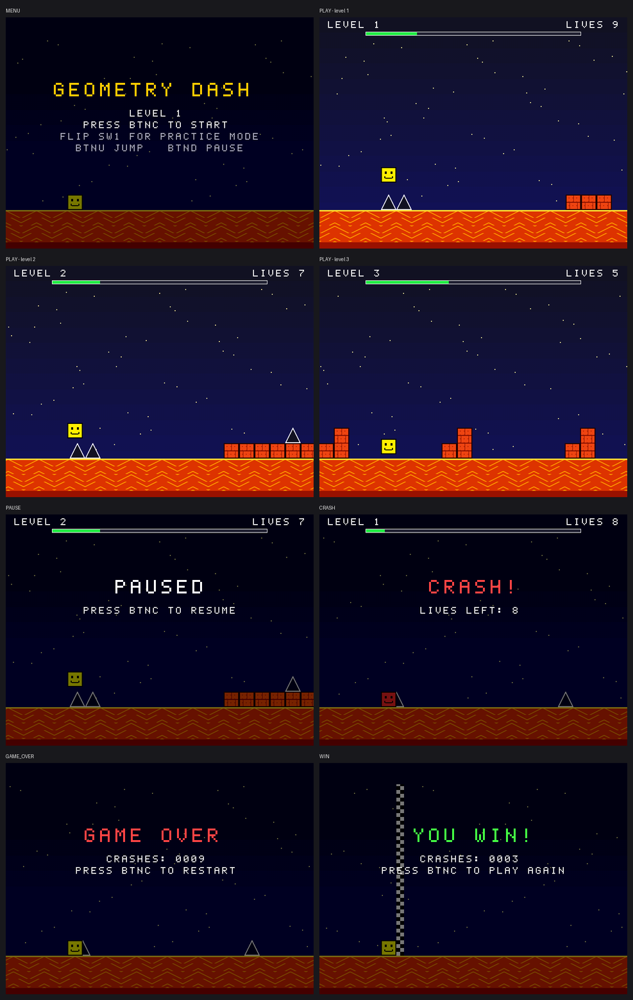

# FPGA Geometry Dash: Nexys A7-100T

A Geometry Dash–style runner game in Verilog for the Digilent Nexys A7-100T. It is built on the EE354 VGA example code and uses the main state machine from the project design. The player is a square that runs on its own; you jump over spikes, onto blocks and up stairs across three levels that get faster each time.



*Every image above was drawn by the RTL in simulation, not mocked up (see [Simulation](#simulation)).*

## Controls

| Input | Action |
|---|---|
| **BtnU** | Jump. Hold it to jump again as soon as you land |
| **BtnC** | Start (MENU), resume (PAUSE), leave GAME OVER / WIN |
| **BtnD** | Pause |
| **BtnL / BtnR** | Pick level 1–3 in the menu (practice mode only) |
| **SW0** | Reset the game (held = stay in INIT) |
| **SW1** | Practice mode: unlimited lives and level select |
| **SW15** | Show the FSM state number on the seven-segment displays |

**Seven-segment displays.** Normally they read `L1 9 0003`: level, lives (`P` in practice mode) and the crash count. With SW15 on they read `StAtE  3`, where the last digit is the state number.

## State machine

`src/game_sm.v` follows the design diagram state for state:

| # | State | What it does | Goes to |
|---|---|---|---|
| 0 | INIT | lives ← 9, crashes ← 0, level ← 1, timer ← 0 | MENU |
| 1 | MENU | SW1 & BtnL: level − 1 · SW1 & BtnR: level + 1 | BtnC → LOAD |
| 2 | LOAD | scroll ← 0, velocity ← 0, runner on the floor | PLAY |
| 3 | PLAY | timer ← 0; on tick: scroll + speed, update runner | hit → CRASH (crashes + 1, lives − 1 if !SW1) · finish & !hit → LEVEL_CLEAR · BtnD → PAUSE |
| 4 | PAUSE | hold all, show PAUSED | BtnC → PLAY |
| 5 | CRASH | on tick: timer + 1, show CRASH | timer = 59 & (lives > 0 \| SW1) → LOAD · timer = 59 & lives = 0 & !SW1 → GAME_OVER |
| 6 | LEVEL_CLEAR | lasts 1 clock | level < 3: level + 1 → LOAD · level = 3 → WIN |
| 7 | GAME_OVER | hold all | BtnC → INIT |
| 8 | WIN | hold all | BtnC → INIT |

A **tick** is one clock per video frame (60 Hz). It fires at the start of vSync, while the screen is blank, so the picture never tears. SW0 forces INIT from any state. INIT also parks the runner at the start so the menu shows a clean scene.

## Files

| File | Origin | Role |
|---|---|---|
| `src/vga_top.v` | EE354 example, extended | Top level: buttons, switches, frame tick, crash counter → decimal, SSD content |
| `src/display_controller.v` | EE354 example, **unchanged** | 640×480 VGA timing |
| `src/vga_bitchange.v` | EE354 example, rewritten | Renderer: (hCount, vCount) → 12-bit colour |
| `src/counter.v` | EE354 example, extended | SSD driver, now 8 digits plus letters (same scan + segment table) |
| `src/game_sm.v` | new | Main FSM, runner physics, collision |
| `src/debouncer.v` | new | ~10 ms debounce, level + one-clock pulse outputs |
| `src/level_rom.v` `font_rom.v` `text_rom.v` | generated | Level layouts, 5×7 font, on-screen messages |
| `constraints/vga_demo.xdc` | EE354 example | Same file with Sw0, Sw1, Sw15, BtnL, BtnR, BtnD enabled |
| `tools/gd_model.py` | new | Python model of the game, level definitions, solver |
| `tools/gen_roms.py` | new | Writes the three ROM files and the test jump schedules |
| `sim/` | new | Testbenches + `run_all.sh` |

## Building in Vivado

**GUI:** create an RTL project for part **xc7a100tcsg324-1**. Add every file in `src/` as a design source and `constraints/vga_demo.xdc` as the constraint. Set `vga_top` as the top module, then generate the bitstream.

**Batch:** `vivado -mode batch -source build.tcl` writes `vivado/gd_nexys.runs/impl_1/vga_top.bit`, plus utilization and timing reports.

Expected size, from a Yosys `synth_xilinx` run: about 2,800 LUTs and 250 flip-flops, roughly 4–5% of the XC7A100T. No block RAM; the ROMs are LUT logic.

## How it works

- **World:** each level is a row of 32-px tiles (`level_rom`). `scroll` is the world x at the left edge of the screen. It grows by 4, 5 or 6 px per frame on levels 1, 2 and 3, and the level is cleared at scroll = 7168. That is about 30 s, 24 s and 20 s.
- **Runner:** a 32×32 square at screen x = 128. `runner_h` is the height of its bottom above the floor. Jumping sets the speed to 12 px/frame and gravity removes 1 px/frame each frame, so a jump peaks about 78 px up.
- **Collision:** `game_sm` looks up the 1–2 tiles under the runner and works out two things:
  - **support:** the highest block top it can stand on. You can land up to 12 px below a top and snap up onto it.
  - **hit:** whether it touched a spike or ran into the side of a block.

  This logic is pipelined through two register stages so every 100 MHz path stays short. Positions only change once per frame, so the results are always ready by the next tick.
- **Renderer:** everything is drawn per pixel with no frame buffer. Front to back: text, HUD progress bar, runner, finish line, spikes/bricks, lava floor, starry sky. The sky uses a dithered gradient and the stars scroll at 1/8 speed. The lava cracks scroll with the world. Menu, pause and end screens dim the scene behind the text.

## Changing the levels

The levels are text strings in `tools/gd_model.py`, one character per 32-px tile:

```
'.' empty   '^' spike   '#' block (32 tall)   'H' block (64 tall)   'A' block with a spike on top
```

After editing, run `python3 tools/gd_model.py` to check that every level is still beatable and to see the tightest jump timing window. Then run `python3 tools/gen_roms.py` to regenerate `src/level_rom.v`. The solver searches every possible jump timing, so if it says a level is beatable, it is. Current timing windows: level 1 ≥ 6 frames, level 2 ≥ 7, level 3 ≥ 4.

Messages and the font are also in `tools/gen_roms.py`.

## Simulation

`bash sim/run_all.sh` (needs `iverilog`, `python3` and Pillow; `verilator` is optional) runs the following:

1. **`tb_game_sm`**: replays a winning run of all three levels through the RTL using the solver's jump inputs, with a pause partway through level 1. It also checks the menu, level select, crash/lives bookkeeping, the 1-second CRASH screen, GAME_OVER after 9 crashes, practice mode and SW0 reset. `tools/check_trace.py` then compares the RTL's scroll and height against the Python model **on every tick (4,424 of them), with no differences**.
2. **`tb_top`**: the whole chip at 100 MHz with real debouncers. It checks the hSync/vSync periods (800 × 525), exactly one tick per frame, button presses, jumping, and the seven-segment scan (`L1 9 0000`, and `StAtE  3` with SW15). It also captures a full frame straight from the VGA pins (`docs/screens/vga_pin_capture.png`).
3. **`make_frames.py`**: renders every screen to PNG (`sim/out/frame_*.png`).

## Notes

- `display_controller.v` is the example file, unchanged. It makes its 25 MHz pixel clock from flip-flops, like the class template, so Vivado may warn about it. As in the template, its hCount/vCount have no reset; they power up at 0 on the FPGA, and the testbench sets that start value itself.
- Because `bright` comes out one pixel after `hCount`, the renderer uses x = hCount − 145. That puts pixel 0 at the left edge.
- I could not run Vivado here. The RTL was checked with Icarus and Verilator and synthesized with Yosys for 7-series. After your first build, look at the timing summary for the 100 MHz `ClkPort` paths.

## Credits

Gameplay idea and art style (lava floor, smiley cube, brick blocks, starry sky) from [raiyan37/FPGA-Geometry-Dash](https://github.com/raiyan37/FPGA-Geometry-Dash), which targets the DE1-SoC. VGA timing, top-level, renderer and SSD skeleton from the EE354 example code.
